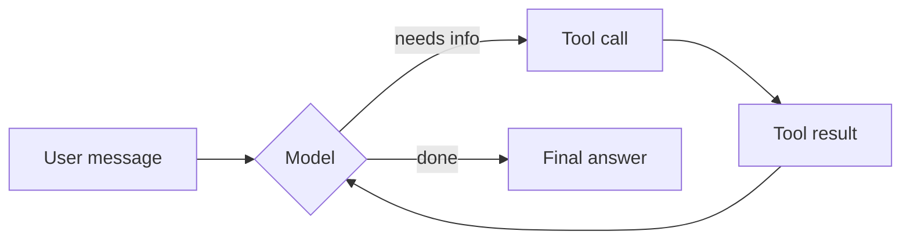

# LangChain Foundations — The Master Book
{: .fs-9 }

A read-it-like-a-book companion to LangChain Academy's **Introduction to LangChain (Python)** course and its repo [`langchain-ai/lca-lc-foundations`](https://github.com/langchain-ai/lca-lc-foundations).
{: .fs-6 .fw-300 }

[Start with Setup](setup.html){: .btn .btn-primary .mr-2 } [Jump to Module 1](module-1.html){: .btn }

---

## Who this book is for

You know some Python and want to understand **what every line of agent code is doing** — not just copy-paste a notebook. Every chapter follows the same pattern:

1. **The idea** — what problem the feature solves, in plain English.
2. **The code** — a small, runnable snippet.
3. **Line-by-line** — what each part does and why it's there.
4. **Try it / Gotchas** — small experiments and common mistakes.

{: .note }
> The code here is written to *explain* the concepts in the course notebooks. It follows the same LangChain v1 APIs (`create_agent`, `@tool`, middleware, etc.), but the notebooks in the official repo are the source of truth — open them side by side.

---

## The big picture in one diagram

Everything in this course is built on one object: **the agent**. An agent is a loop — the model thinks, optionally calls tools, reads the results, and repeats until it can answer.



Each module adds a layer on top of this loop:

| Module | Theme | What you add to the agent | Project |
|---|---|---|---|
| [1 — Create Agent](module-1.html) | The basics | Models, prompts, tools, memory, images/audio | 🧑‍🍳 Personal Chef |
| [2 — Advanced Agent](module-2.html) | Wiring things together | MCP tools, runtime context, custom state, sub-agents | 💍 Wedding Planner |
| [3 — Production-Ready Agent](module-3.html) | Control & safety | Middleware: summarising, human approval, dynamic model/prompt/tools | 📧 Email Assistant |

---

## How the repo maps to this book

```text
lca-lc-foundations/
├── example.env              → copy to .env (your API keys)
├── env_utils.py             → checks your setup        (Setup chapter)
├── pyproject.toml / uv.lock → dependencies for uv
├── requirements.txt         → dependencies for pip
└── notebooks/
    ├── module-1/            → Chapter: Module 1
    │   ├── 1.1_foundational_models.ipynb
    │   ├── 1.1_prompting.ipynb
    │   ├── 1.2_tools.ipynb
    │   ├── 1.2_web_search.ipynb
    │   ├── 1.3_memory.ipynb
    │   ├── 1.4_multimodal_messages.ipynb
    │   ├── 1.5_personal_chef.ipynb / .py
    │   └── langgraph.json   → lets Studio find the agent
    ├── module-2/            → Chapter: Module 2
    │   ├── 2.1_mcp.ipynb, 2.1_travel_agent.ipynb
    │   ├── 2.2_runtime_context.ipynb, 2.2_state.ipynb
    │   ├── 2.3_multi_agent.ipynb
    │   ├── 2.4_wedding_planners.ipynb
    │   └── bonus_rag.ipynb, bonus_sql.ipynb
    └── module-3/            → Chapter: Module 3
        ├── 3.2_managing_messages.ipynb
        ├── 3.3_hitl.ipynb
        ├── 3.4_dynamic_models / _prompts / _tools.ipynb
        ├── 3.5_email_agent.ipynb / .py
        ├── agent-chat-ui/   → Bonus: chat front-end
        └── langgraph.json
```

---

## Reading order

1. [Setup](setup.html) — get keys, install, verify.
2. [Module 1](module-1.html) — build your first agent.
3. [Module 2](module-2.html) — give it context, state and teammates.
4. [Module 3](module-3.html) — make it safe and production-shaped.
5. [Cheat Sheet & Troubleshooting](cheatsheet.html) — keep this open while coding.
