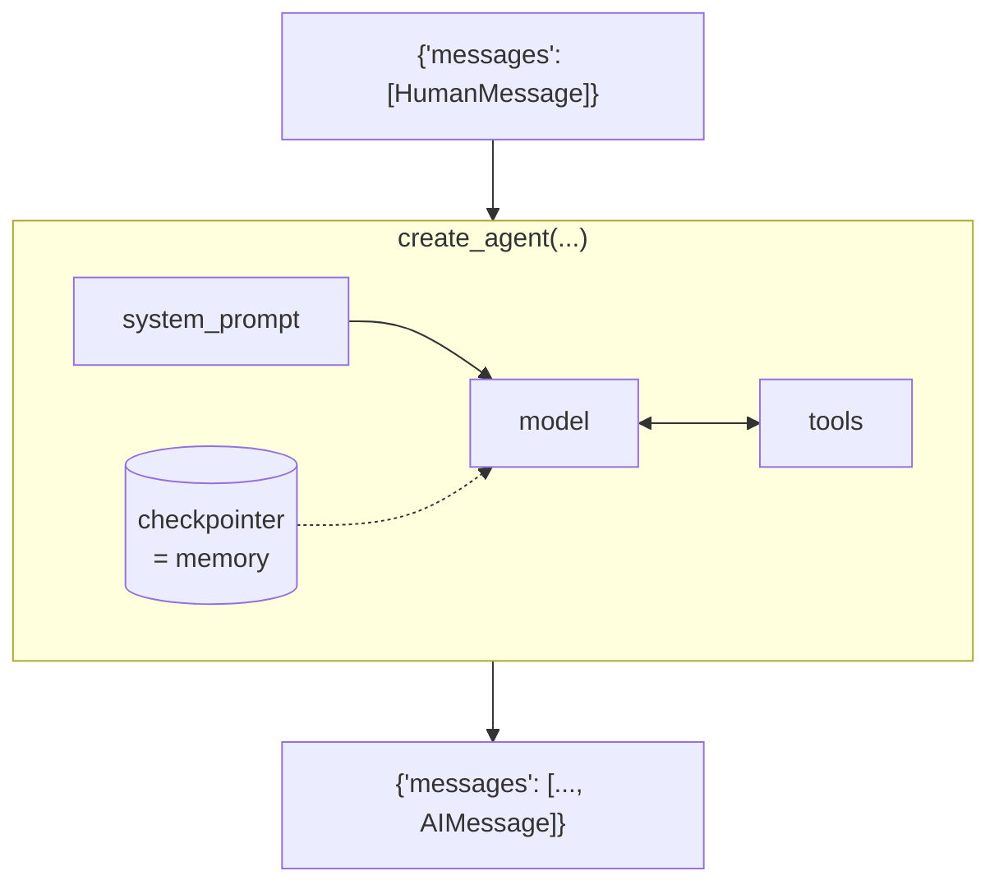
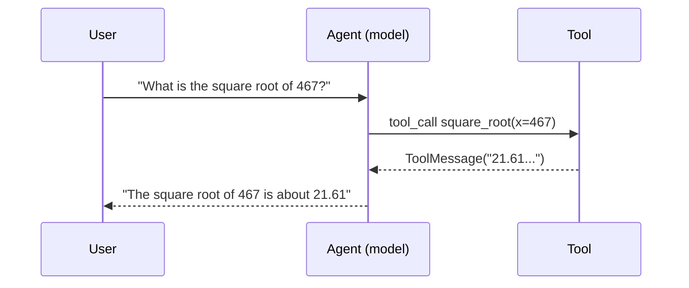

# Module 1 — Create Agent
{: .no_toc }

From a single model call to a web-searching, memory-keeping, image-reading agent.
{: .fs-5 .fw-300 }

<details open markdown="block">
<summary>Contents</summary>
{: .text-delta }
- TOC
{:toc}
</details>

---

## Mental model for this module



By the end you'll understand each box: **model** (1.1), **system prompt** (1.1), **tools** (1.2), **checkpointer/memory** (1.3), and **message content types** (1.4).

---

## Lesson 1.1 — Foundational models
*Notebook: `1.1_foundational_models.ipynb`*

### The idea
A *chat model* takes a list of messages and returns one new message. LangChain wraps every provider (OpenAI, Anthropic, Google, …) behind the **same interface**, so swapping providers is a one-string change.

### The code

```python
from dotenv import load_dotenv
load_dotenv()

from langchain.chat_models import init_chat_model

model = init_chat_model("gpt-5-nano")              # provider inferred from the name
response = model.invoke("What is the capital of the Moon?")

print(type(response).__name__)                     # AIMessage
print(response.content)                            # the text answer
```

### Line-by-line

| Line | What it does |
|---|---|
| `init_chat_model("gpt-5-nano")` | Builds a chat-model object. You can be explicit: `"openai:gpt-5-nano"`, `"anthropic:claude-sonnet-4-5"`, `"google_genai:gemini-2.5-flash-lite"`. |
| `model.invoke(...)` | Sends the input and waits for the full reply. A plain string is treated as one human message. |
| `response` | An **`AIMessage`**. `.content` = text, `.usage_metadata` = token counts, `.response_metadata` = provider details. |

### Model parameters

```python
model = init_chat_model(
    model="gpt-5-nano",
    temperature=1.0,     # randomness (some reasoning models only accept the default)
    max_tokens=500,      # cap on reply length
    timeout=30,          # seconds
)
```

### Same code, different provider

```python
claude = init_chat_model("anthropic:claude-sonnet-4-5")      # needs ANTHROPIC_API_KEY
gemini = init_chat_model("google_genai:gemini-2.5-flash-lite") # needs GOOGLE_API_KEY

for m in (claude, gemini):
    print(m.invoke("One sentence on why the sky is blue.").content)
```

This is the only place in the course the optional Anthropic/Google keys are used.

### From model to agent

```python
from langchain.agents import create_agent
from langchain.messages import HumanMessage

agent = create_agent(model="gpt-5-nano")        # a model string OR a model object

result = agent.invoke({"messages": [HumanMessage("What's the capital of the Moon?")]})
print(result["messages"][-1].content)
```

**Key differences between `model.invoke` and `agent.invoke`:**

| | `model.invoke` | `agent.invoke` |
|---|---|---|
| Input | string or list of messages | a **dict** of state: `{"messages": [...]}` |
| Output | one `AIMessage` | the **whole state** dict; the answer is `result["messages"][-1]` |
| Can use tools / memory / middleware | No | Yes |

### Streaming (see the agent think)

```python
for step in agent.stream(
    {"messages": [HumanMessage("Tell me a joke about astronauts")]},
    stream_mode="values",                 # emit the full state after each step
):
    step["messages"][-1].pretty_print()   # pretty_print shows role + content nicely
```

---

## Lesson 1.1b — Prompting
*Notebook: `1.1_prompting.ipynb`*

### The idea
The **system prompt** is the agent's job description. It is sent before every conversation and shapes tone, rules, and format.

```python
system_prompt = """You are a science-fiction writer.
Answer every question as a short in-universe story of at most 3 sentences."""

agent = create_agent(model="gpt-5-nano", system_prompt=system_prompt)
result = agent.invoke({"messages": [HumanMessage("What's the capital of the Moon?")]})
print(result["messages"][-1].content)
```

### Prompting techniques you'll see

| Technique | How | Why |
|---|---|---|
| Role | "You are a …" | Sets voice and expertise. |
| Constraints | "At most 3 sentences", "Never invent prices" | Controls length and safety. |
| Few-shot examples | Put 1–3 sample Q→A pairs in the prompt | Shows the exact format you want. |
| Output structure | `response_format=` (below) | Guarantees machine-readable output. |

### Structured output — get a Python object, not text

```python
from pydantic import BaseModel

class CapitalInfo(BaseModel):
    name: str
    location: str
    vibe: str
    economy: str

agent = create_agent(
    model="gpt-5-nano",
    system_prompt=system_prompt,
    response_format=CapitalInfo,        # ask the agent to fill this schema
)

result = agent.invoke({"messages": [HumanMessage("What's the capital of the Moon?")]})
info = result["structured_response"]     # a CapitalInfo instance
print(info.name, "|", info.vibe)
```

- `response_format` → the agent's final step must return data matching the Pydantic model.
- `result["structured_response"]` → the validated object; use it like any Python object.

---

## Lesson 1.2 — Tools
*Notebooks: `1.2_tools.ipynb`, `1.2_web_search.ipynb`*

### The idea
Models can't do math reliably, look things up, or touch your systems. **Tools** are ordinary Python functions the model can *ask* to run. The model never executes code; it emits a *tool call* (name + arguments), LangChain runs the function, and returns the result as a `ToolMessage`.



### Defining a tool

```python
from langchain.tools import tool

@tool
def square_root(x: float) -> float:
    """Calculate the square root of a number."""
    return x ** 0.5
```

What the model actually "sees" is built from three things:

| Part | Becomes | Tip |
|---|---|---|
| Function name `square_root` | tool name | Use clear verb-noun names. |
| Type hints `x: float` | JSON schema of arguments | Always type every argument. |
| Docstring | tool description | The model decides *when* to call the tool from this — write it well. |

You can override them:

```python
@tool("square_root", description="Calculate the square root of a number")
def tool1(x: float) -> float:
    return x ** 0.5

print(tool1.name, tool1.description, tool1.args)   # inspect what the model will see
print(tool1.invoke({"x": 467}))                    # tools are runnable on their own
```

### Giving tools to an agent

```python
agent = create_agent(
    model="gpt-5-nano",
    tools=[square_root],
    system_prompt="You are an arithmetic wizard. Always use your tools for calculations.",
)

result = agent.invoke({"messages": [HumanMessage("What is the square root of 467?")]})
for msg in result["messages"]:
    msg.pretty_print()
```

You'll see four messages: **Human → AI (with `tool_calls`) → Tool → AI (final answer)**. Inspect the tool call:

```python
ai_msg = result["messages"][1]
print(ai_msg.tool_calls)   # [{'name': 'square_root', 'args': {'x': 467}, 'id': 'call_...'}]
```

### Web search tool with Tavily

```python
from typing import Any, Dict
from tavily import TavilyClient

tavily_client = TavilyClient()          # reads TAVILY_API_KEY from the environment

@tool
def web_search(query: str) -> Dict[str, Any]:
    """Search the web for information."""
    return tavily_client.search(query)

agent = create_agent(model="gpt-5-nano", tools=[web_search])
result = agent.invoke({"messages": [HumanMessage("Who won the most recent Formula 1 race?")]})
print(result["messages"][-1].content)
```

Why this matters: the model's knowledge is frozen at its training date. A search tool turns it into an agent that can answer *current* questions.

{: .warning }
> **Gotchas**
> - Missing/vague docstring → the model ignores the tool or misuses it.
> - Returning huge objects (whole web pages) burns tokens; trim results when you can.
> - Tools can fail — return a helpful error string rather than raising, so the model can recover.

---

## Lesson 1.3 — Short-term memory
*Notebook: `1.3_memory.ipynb`*

### The idea
By default each `invoke` is a **blank slate** — the agent forgets your name between calls. Short-term memory = saving the conversation's state after each turn and reloading it next turn. LangChain does this with a **checkpointer** plus a **thread ID**.

### Without memory

```python
agent = create_agent(model="gpt-5-nano")
agent.invoke({"messages": [HumanMessage("Hi, my name is Seán and my favourite colour is green.")]})
r = agent.invoke({"messages": [HumanMessage("What's my favourite colour?")]})
print(r["messages"][-1].content)     # "I don't know your favourite colour..."
```

### With memory

```python
from langgraph.checkpoint.memory import InMemorySaver

agent = create_agent(
    model="gpt-5-nano",
    checkpointer=InMemorySaver(),          # 1. where to save state
)

config = {"configurable": {"thread_id": "1"}}   # 2. which conversation

agent.invoke({"messages": [HumanMessage("Hi, my name is Seán and my favourite colour is green.")]},
             config)
r = agent.invoke({"messages": [HumanMessage("What's my favourite colour?")]}, config)
print(r["messages"][-1].content)     # "Green!"
```

| Piece | Role |
|---|---|
| `InMemorySaver()` | Stores a snapshot of state after every step, in RAM. Lost when the process stops. |
| `thread_id` | A conversation ID. Same ID → same history. New ID → fresh conversation. |
| `config` | Must be passed on **every** call you want remembered. |

{: .tip }
In production you swap `InMemorySaver` for a persistent checkpointer (e.g. Postgres or SQLite). The agent code doesn't change. When you run under `langgraph dev` / LangSmith deployment, persistence is provided for you.

**Try it:** change `thread_id` to `"2"` and ask again — the agent won't know you.

---

## Lesson 1.4 — Multimodal messages
*Notebook: `1.4_multimodal_messages.ipynb`*

### The idea
A message's `content` doesn't have to be a string. It can be a **list of content blocks** — text, image, audio, file — so the model can "see" and "hear".

### Sending an image

```python
import base64
from langchain.messages import HumanMessage

with open("resources/moon.png", "rb") as f:
    img_b64 = base64.b64encode(f.read()).decode("utf-8")

msg = HumanMessage(content=[
    {"type": "text",  "text": "Describe this picture in one sentence."},
    {"type": "image", "base64": img_b64, "mime_type": "image/png"},
])

agent = create_agent(model="gpt-5-nano")
r = agent.invoke({"messages": [msg]})
print(r["messages"][-1].content)
```

| Step | Why |
|---|---|
| Read file in `"rb"` mode | Images are binary. |
| `base64.b64encode(...)` | APIs accept binary as base64 text. |
| `{"type": "image", ...}` | LangChain's **standard content block** — the same shape works across providers. |
| `"mime_type"` | Tells the model the format (png/jpeg). |

You can also pass a URL: `{"type": "image", "url": "https://..."}`.

### Audio
Audio works the same way with `{"type": "audio", "base64": ..., "mime_type": "audio/wav"}`, but needs a model that supports audio input — the notebook switches to an audio-capable OpenAI model for that cell.

{: .note }
Not every model supports every modality. If you get an error about unsupported content, check the provider's model card.

---

## Lesson 1.5 — Project: Personal Chef 🧑‍🍳
*Files: `1.5_personal_chef.ipynb`, `1.5_personal_chef.py`*

### The brief
The user lists leftover ingredients (or sends a photo of the fridge). The agent searches the web for recipes that use them and, on request, gives full instructions — remembering the conversation.

### How it combines Module 1

| Lesson | Used for |
|---|---|
| 1.1 Model + prompt | `gpt-5-nano` with a "personal chef" system prompt |
| 1.2 Tools | `web_search` via Tavily |
| 1.3 Memory | Follow-ups like "give me the full recipe for the 2nd one" |
| 1.4 Multimodal | Optional: send a fridge photo instead of a list |

### Full code

```python
from dotenv import load_dotenv
load_dotenv()

from typing import Any, Dict
from tavily import TavilyClient
from langchain.tools import tool
from langchain.agents import create_agent
from langchain.messages import HumanMessage
from langgraph.checkpoint.memory import InMemorySaver

# 1) Tool: lets the agent look up real recipes
tavily_client = TavilyClient()

@tool
def web_search(query: str) -> Dict[str, Any]:
    """Search the web for information."""
    return tavily_client.search(query)

# 2) Job description
system_prompt = """You are a personal chef. The user will give you a list of ingredients
they have left over. Use the web search tool to find recipes that can be made with
those ingredients. Return recipe suggestions, and the full instructions if requested."""

# 3) Assemble the agent
agent = create_agent(
    model="gpt-5-nano",
    tools=[web_search],
    system_prompt=system_prompt,
    checkpointer=InMemorySaver(),
)

# 4) Talk to it
config = {"configurable": {"thread_id": "chef-1"}}
r = agent.invoke({"messages": [HumanMessage("I have chicken, spinach, rice and lemons.")]}, config)
print(r["messages"][-1].content)

r = agent.invoke({"messages": [HumanMessage("Give me full instructions for the first one.")]}, config)
print(r["messages"][-1].content)
```

### The `.py` file and Studio
The `.py` version defines `agent` at module level **without** a checkpointer — when you run `langgraph dev`, the server supplies persistence itself. Studio then imports `agent` via `langgraph.json` and lets you chat and watch each tool call visually.

### Extend it
- Add a `response_format` so each suggestion returns `name`, `time_minutes`, `missing_ingredients`.
- Add a "dietary restrictions" line to the system prompt.
- Send a photo of ingredients using the 1.4 pattern.

---

## Module 1 recap

| Concept | One-line summary | API |
|---|---|---|
| Chat model | Same interface for every provider | `init_chat_model("provider:model")` |
| Agent | Model + loop + tools | `create_agent(model, tools, system_prompt)` |
| State | A dict; `messages` is the key list | `agent.invoke({"messages": [...]})` |
| Tool | Typed, documented Python function | `@tool` |
| Memory | Save state per conversation | `checkpointer=InMemorySaver()` + `thread_id` |
| Multimodal | Content = list of blocks | `{"type": "image", "base64": ...}` |
| Structured output | Get a Pydantic object | `response_format=MyModel` |

[Next: Module 2 →](module-2.html){: .btn .btn-primary }
