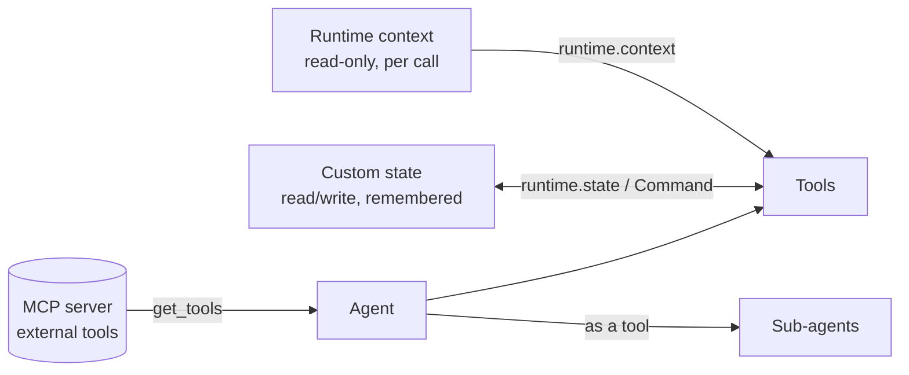
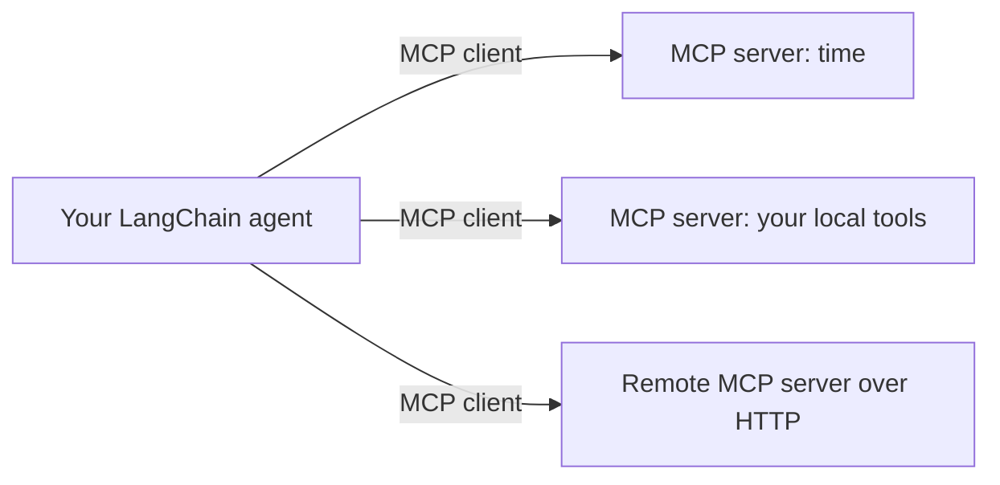
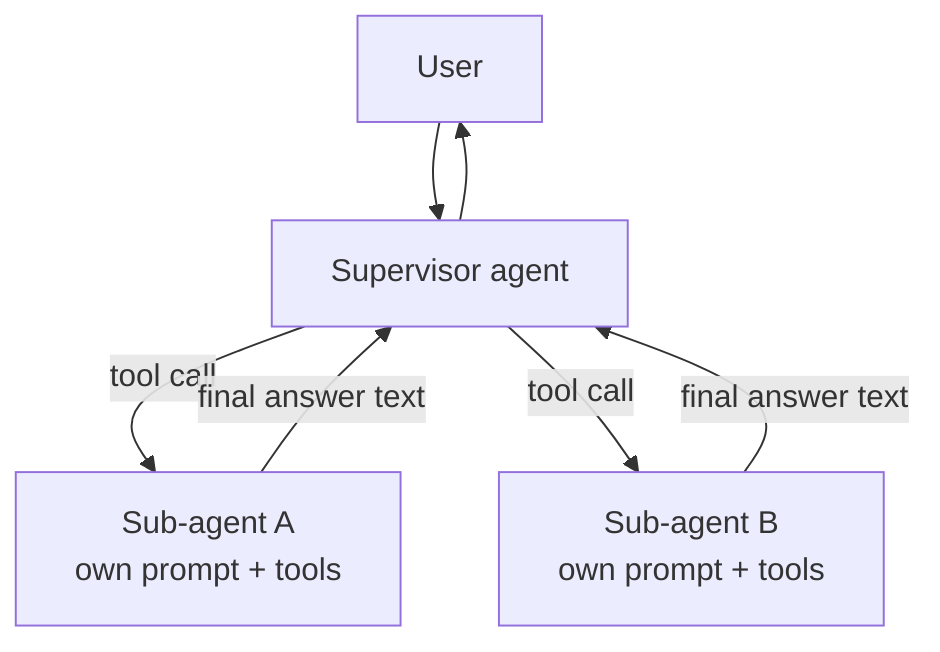
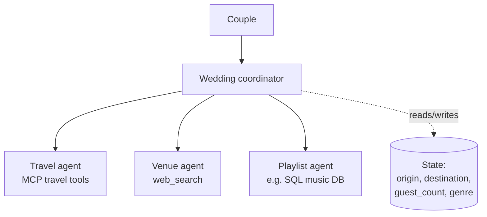

# Module 2 — Advanced Agent
{: .no_toc }

Plug in external tool servers, pass information into tools, let tools change the agent's state, and make agents work as a team.
{: .fs-5 .fw-300 }

<details open markdown="block">
<summary>Contents</summary>
{: .text-delta }
- TOC
{:toc}
</details>

---

## Mental model for this module

In Module 1 the agent only knew two things: its **messages** and its **tools**. Module 2 adds three new sources of information:



| Concept | Who sets it | Can tools change it? | Persisted with memory? | Example |
|---|---|---|---|---|
| **Runtime context** | Your app, at `invoke` time | No (read-only) | No | user ID, DB connection, API client |
| **State** | The agent run | Yes, via `Command` | Yes (with checkpointer) | `authenticated`, `favourite_colour`, messages |

---

## Lesson 2.1 — Model Context Protocol (MCP)
*Notebooks: `2.1_mcp.ipynb`, `2.1_travel_agent.ipynb`*

### The idea
Writing every tool yourself doesn't scale. **MCP** is an open standard that lets any program ("MCP server") publish tools, resources and prompts in a common format. Your agent becomes an **MCP client** and can load those tools without knowing how they're implemented.



**Transports**

| Transport | How it runs | Typical use |
|---|---|---|
| `stdio` | Client launches the server as a local subprocess (e.g. `uvx some-server`, `python server.py`) | Local tools, the course's examples |
| `streamable_http` | Server is already running at a URL | Remote / shared servers |

This is why the course needs **uv**: `uvx` downloads and runs a published MCP server in one command.

### Writing a tiny MCP server (to see both sides)

```python
# resources/my_mcp_server.py  (illustrative)
from mcp.server.fastmcp import FastMCP

mcp = FastMCP("demo")

@mcp.tool()
def add(a: int, b: int) -> int:
    """Add two numbers."""
    return a + b

if __name__ == "__main__":
    mcp.run(transport="stdio")
```

Same idea as `@tool`: the function name, type hints and docstring become the tool's schema.

### Connecting from LangChain

```python
from langchain_mcp_adapters.client import MultiServerMCPClient
from langchain.agents import create_agent
from langchain.messages import HumanMessage

client = MultiServerMCPClient({
    "local": {                                    # any name you like
        "transport": "stdio",
        "command": "python",
        "args": ["resources/my_mcp_server.py"],
    },
    "time": {                                     # a published server run via uvx
        "transport": "stdio",
        "command": "uvx",
        "args": ["mcp-server-time"],
    },
})

tools = await client.get_tools()                  # MCP tools → LangChain tools
print([t.name for t in tools])

agent = create_agent(model="gpt-5-nano", tools=tools)
r = await agent.ainvoke({"messages": [HumanMessage("What time is it in Tokyo? Also add 2 and 40.")]})
print(r["messages"][-1].content)
```

| Line | What it does |
|---|---|
| `MultiServerMCPClient({...})` | One client managing many servers. Each entry says *how to reach* the server. |
| `await client.get_tools()` | Starts/connects to each server, lists its tools, converts them to normal LangChain tools. |
| `ainvoke` / `await` | MCP tools are async, so use the async agent methods. Jupyter supports top-level `await`. |

{: .note }
In a `.py` script wrap the async code in `async def main(): ...` and call `asyncio.run(main())`.

### Travel agent example
`2.1_travel_agent.ipynb` applies the same pattern to a realistic job: an agent that gets travel-related tools from an MCP server and plans a trip. Pay attention to how the **system prompt** tells the agent which tools to use for which sub-task — mixing many MCP tools makes good prompting more important.

{: .warning }
> **Gotchas**
> - `uvx: command not found` → install uv and restart your terminal/Jupyter.
> - First run of `uvx` downloads the server, so it can be slow.
> - Only connect to MCP servers you trust — they run code on your machine.

---

## Lesson 2.2a — Runtime context
*Notebook: `2.2_runtime_context.ipynb`*

### The idea
Tools often need information the **model shouldn't control** — the current user's ID, a database handle, a feature flag. You don't want the model to invent these as tool arguments. Instead you pass them as **runtime context** when calling the agent, and tools read them directly.

### The code

```python
from dataclasses import dataclass
from langchain.tools import tool, ToolRuntime
from langchain.agents import create_agent
from langchain.messages import HumanMessage

@dataclass
class ColourContext:
    favourite_colour: str = "blue"
    least_favourite_colour: str = "yellow"

@tool
def get_favourite_colour(runtime: ToolRuntime) -> str:
    """Get the user's favourite colour."""
    return runtime.context.favourite_colour

@tool
def get_least_favourite_colour(runtime: ToolRuntime) -> str:
    """Get the user's least favourite colour."""
    return runtime.context.least_favourite_colour

agent = create_agent(
    model="gpt-5-nano",
    tools=[get_favourite_colour, get_least_favourite_colour],
    context_schema=ColourContext,            # declares the shape of the context
)

r = agent.invoke(
    {"messages": [HumanMessage("What is my favourite colour?")]},
    context=ColourContext(favourite_colour="green"),   # supplied per call
)
print(r["messages"][-1].content)            # "...green"
```

### Line-by-line

| Piece | Meaning |
|---|---|
| `@dataclass ColourContext` | A typed container. Defaults make it easy to test. |
| `context_schema=ColourContext` | Tells the agent what type `context` will be. |
| `runtime: ToolRuntime` | A **special parameter**. LangChain injects it and **hides it from the model** — the model never sees or fills it. |
| `runtime.context` | The object you passed in `invoke(..., context=...)`. |

**Real-world uses:** `user_id` for per-user data, a SQL connection (see `bonus_sql.ipynb`), API clients, locale/timezone, permissions.

---

## Lesson 2.2b — State
*Notebook: `2.2_state.ipynb`*

### The idea
Context is read-only. **State** is the agent's working memory — it starts with `messages`, but you can add your own fields, and **tools can update them**. With a checkpointer, those fields persist across turns just like messages.

### Step 1 — Extend the state schema

```python
from langchain.agents import AgentState

class CustomState(AgentState):          # AgentState already contains `messages`
    favourite_colour: str
```

### Step 2 — A tool that *writes* state

```python
from langchain.tools import tool, ToolRuntime
from langchain.messages import ToolMessage
from langgraph.types import Command

@tool
def update_favourite_colour(favourite_colour: str, runtime: ToolRuntime) -> Command:
    """Update the user's favourite colour in the state."""
    return Command(update={
        "favourite_colour": favourite_colour,
        "messages": [
            ToolMessage("Successfully updated favourite colour",
                        tool_call_id=runtime.tool_call_id),
        ],
    })
```

| Piece | Why it's needed |
|---|---|
| Return `Command(update=...)` | Instead of returning text, the tool returns *instructions to change state*. |
| `"favourite_colour": ...` | The new value for your custom field. |
| `ToolMessage(..., tool_call_id=...)` | Every tool call **must** get a matching tool result message; since we're not returning a plain value, we add it ourselves. `runtime.tool_call_id` gives the ID. |

### Step 3 — A tool that *reads* state

```python
@tool
def read_favourite_colour(runtime: ToolRuntime) -> str:
    """Read the user's favourite colour from the state."""
    return runtime.state.get("favourite_colour", "unknown")
```

### Step 4 — Wire it up

```python
from langgraph.checkpoint.memory import InMemorySaver

agent = create_agent(
    model="gpt-5-nano",
    tools=[update_favourite_colour, read_favourite_colour],
    state_schema=CustomState,
    checkpointer=InMemorySaver(),
)

config = {"configurable": {"thread_id": "1"}}
r = agent.invoke({"messages": [HumanMessage("My favourite colour is purple.")]}, config)
print(r["favourite_colour"])            # 'purple' — visible directly in the returned state

r = agent.invoke({"messages": [HumanMessage("What's my favourite colour?")]}, config)
print(r["messages"][-1].content)
```

You can also **seed** state on invoke: `agent.invoke({"messages": [...], "favourite_colour": "red"}, config)`.

### Context vs State — decision rule
- *Does the model or a tool need to change it during the conversation?* → **State**
- *Is it fixed for this call and supplied by your app?* → **Context**

---

## Lesson 2.3 — Multi-agent systems
*Notebook: `2.3_multi_agent.ipynb`*

### The idea
One agent with 30 tools and a giant prompt gets confused. Split the work: **specialist sub-agents**, each with a focused prompt and toolset, coordinated by a **supervisor** agent. The simplest pattern in LangChain: **wrap a sub-agent as a tool**.



### The code

```python
from langchain.tools import tool
from langchain.agents import create_agent
from langchain.messages import HumanMessage

# 1) A specialist
@tool
def square_root(x: float) -> float:
    """Calculate the square root of a number."""
    return x ** 0.5

math_agent = create_agent(
    model="gpt-5-nano",
    tools=[square_root],
    system_prompt="You are a math specialist. Use your tools for every calculation.",
)

# 2) Expose the specialist as a tool
@tool
def call_math_agent(query: str) -> str:
    """Delegate a math question to the math specialist."""
    result = math_agent.invoke({"messages": [HumanMessage(query)]})
    return result["messages"][-1].content       # only the final answer goes back

# 3) The supervisor
supervisor = create_agent(
    model="gpt-5-nano",
    tools=[call_math_agent],
    system_prompt="You coordinate specialists. Delegate math to the math agent.",
)

r = supervisor.invoke({"messages": [HumanMessage("What's the square root of 456?")]})
print(r["messages"][-1].content)
```

### Why this design works
- **Context isolation** — the sub-agent's intermediate steps don't clutter the supervisor's history; only the final answer returns.
- **Focused prompts** — each agent does one job well.
- **Parallelism** — the supervisor can call several sub-agents in one step.

{: .tip }
The **tool description** of `call_math_agent` is how the supervisor decides to delegate. Write it like a job advert: what the specialist does and what input it expects.

---

## Lesson 2.4 — Project: Wedding Planner 💍
*Notebook: `2.4_wedding_planners.ipynb`*

### The brief
A coordinator agent plans a wedding by delegating to specialists — e.g. **travel/flights**, **venue**, and **playlist/music** — each with its own tools. It combines *everything* from Module 2.



### Building blocks and where they come from

| Building block | Lesson | Role in the planner |
|---|---|---|
| MCP tools | 2.1 | Travel/flight look-ups |
| `web_search` | 1.2 | Venue research |
| Custom state | 2.2 | Store wedding details once (origin, destination, guests, music genre) so every specialist reads the same facts |
| `Command` updates | 2.2 | A tool that records the couple's preferences into state |
| Sub-agents as tools | 2.3 | Each specialist runs separately and returns a summary |

### Skeleton (illustrative)

```python
from langchain.agents import create_agent, AgentState
from langchain.tools import tool, ToolRuntime
from langchain.messages import HumanMessage, ToolMessage
from langgraph.types import Command

class WeddingState(AgentState):
    origin: str
    destination: str
    guest_count: str
    genre: str

# --- specialists (each built with create_agent + its own tools/prompt) ---
travel_agent   = create_agent(model="gpt-5-nano", tools=travel_tools,  system_prompt="You find flights...")
venue_agent    = create_agent(model="gpt-5-nano", tools=[web_search],  system_prompt="You find venues...")
playlist_agent = create_agent(model="gpt-5-nano", tools=music_tools,   system_prompt="You build playlists...")

# --- specialists as tools, reading shared state ---
@tool
async def search_flights(runtime: ToolRuntime) -> str:
    """Ask the travel specialist for flights between the stored origin and destination."""
    s = runtime.state
    q = f"Find flights from {s['origin']} to {s['destination']}."
    r = await travel_agent.ainvoke({"messages": [HumanMessage(q)]})
    return r["messages"][-1].content

@tool
def search_venues(runtime: ToolRuntime) -> str:
    """Ask the venue specialist for venues in the destination for the guest count."""
    s = runtime.state
    q = f"Find wedding venues in {s['destination']} for {s['guest_count']} guests."
    return venue_agent.invoke({"messages": [HumanMessage(q)]})["messages"][-1].content

@tool
def suggest_playlist(runtime: ToolRuntime) -> str:
    """Ask the playlist specialist for a playlist in the stored genre."""
    q = f"Create a wedding playlist of {runtime.state['genre']} music."
    return playlist_agent.invoke({"messages": [HumanMessage(q)]})["messages"][-1].content

# --- a tool that writes the couple's details into state ---
@tool
def update_state(origin: str, destination: str, guest_count: str, genre: str,
                 runtime: ToolRuntime) -> Command:
    """Save the wedding details: origin, destination, guest count and music genre."""
    return Command(update={
        "origin": origin, "destination": destination,
        "guest_count": guest_count, "genre": genre,
        "messages": [ToolMessage("Wedding details saved", tool_call_id=runtime.tool_call_id)],
    })

coordinator = create_agent(
    model="gpt-5-nano",
    tools=[update_state, search_flights, search_venues, suggest_playlist],
    state_schema=WeddingState,
    system_prompt=("You are a wedding coordinator. First save the couple's details with "
                   "update_state, then delegate to the specialists and combine their answers."),
)
```

**Flow:** user describes the wedding → coordinator calls `update_state` → state now holds the facts → coordinator calls each specialist tool → each reads state, runs its sub-agent, returns a summary → coordinator writes the final plan.

---

## Bonus notebooks

| Notebook | What it shows | Concepts reused |
|---|---|---|
| `bonus_rag.ipynb` | **Retrieval-Augmented Generation**: load documents, split, embed into a vector store, and give the agent a *retriever tool* so it answers from your documents. | Tools (1.2) |
| `bonus_sql.ipynb` | An agent that queries a SQL database — the DB connection is passed via **runtime context**, and tools run SQL. | Context (2.2), Tools |

---

## Module 2 recap

| Concept | One-line summary | API |
|---|---|---|
| MCP | Load tools from any MCP server | `MultiServerMCPClient(...).get_tools()` |
| Runtime context | Read-only, per-call data for tools | `context_schema=`, `invoke(..., context=)`, `runtime.context` |
| Hidden runtime arg | Injected, invisible to the model | `runtime: ToolRuntime` |
| Custom state | Extra fields the agent remembers | `class S(AgentState)`, `state_schema=S` |
| Update state from a tool | Return a command | `Command(update={..., "messages": [ToolMessage(...)]})` |
| Multi-agent | Sub-agent wrapped in a `@tool` | `sub.invoke(...)["messages"][-1].content` |

[← Module 1](module-1.html){: .btn } [Next: Module 3 →](module-3.html){: .btn .btn-primary }
