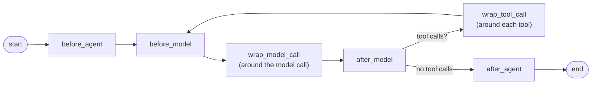
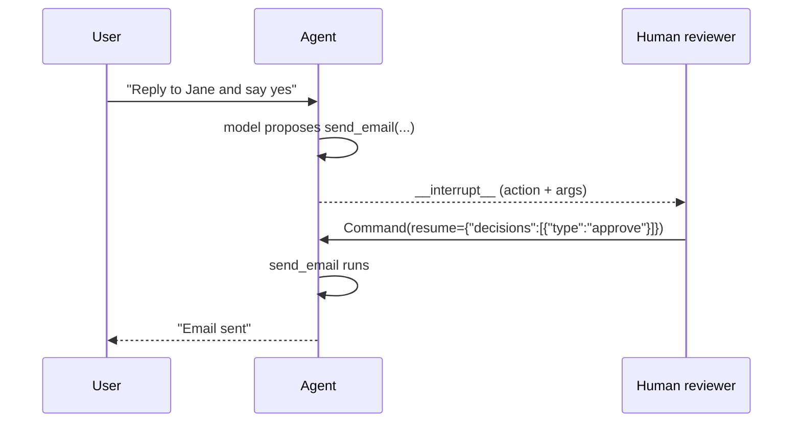
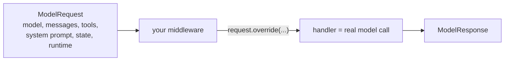
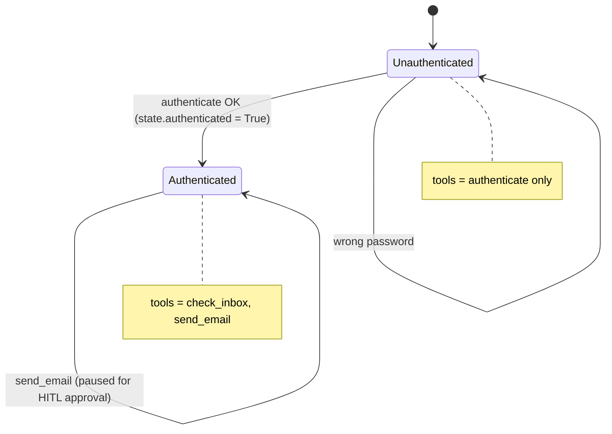

# Module 3 — Production-Ready Agent
{: .no_toc }

Middleware: the hooks that let you control, trim, pause and reshape an agent at every step.
{: .fs-5 .fw-300 }

<details open markdown="block">
<summary>Contents</summary>
{: .text-delta }
- TOC
{:toc}
</details>

---

## Lesson 3.1 — What is middleware?

### The idea
`create_agent` runs a fixed loop: **call model → run tools → call model → …**. Middleware lets you plug code **into that loop** without rewriting it — like plugins.



| Hook | Runs | Typical use |
|---|---|---|
| `before_agent` / `after_agent` | Once per `invoke` | Load/save data, auth, logging |
| `before_model` | Before **every** model call | Trim or summarise messages, guardrails |
| `after_model` | After every model call | Validate output, **pause for human approval** |
| `wrap_model_call` | *Around* the model call | Change **model, prompt, tools** for this call; retries; fallbacks |
| `wrap_tool_call` | *Around* each tool | Retry, error handling, monitoring |
| `dynamic_prompt` | Shortcut for `wrap_model_call` | Build the system prompt at runtime |

You attach middleware with one list:

```python
agent = create_agent(
    model="gpt-5-nano",
    tools=[...],
    middleware=[mw1, mw2, mw3],     # executed in order
)
```

Two kinds:
- **Built-in** (`SummarizationMiddleware`, `HumanInTheLoopMiddleware`, …) — configure and use.
- **Custom** — decorate a function with `@before_model`, `@wrap_model_call`, `@dynamic_prompt`, etc.

The rest of the module is middleware applied to real problems.

---

## Lesson 3.2 — Managing long conversations
*Notebook: `3.2_managing_messages.ipynb`*

### The problem
Every turn adds messages. Eventually you hit the model's **context limit**, cost rises, and quality drops. Two fixes:

| Strategy | What happens | Trade-off |
|---|---|---|
| **Summarise** | Older messages are replaced by an LLM-written summary | Keeps meaning, costs an extra model call |
| **Trim / delete** | Older messages are removed | Free and simple, but information is lost |

### Option A — Built-in summarisation

```python
from langchain.agents import create_agent
from langchain.agents.middleware import SummarizationMiddleware
from langgraph.checkpoint.memory import InMemorySaver

agent = create_agent(
    model="gpt-5-nano",
    checkpointer=InMemorySaver(),
    middleware=[
        SummarizationMiddleware(
            model="gpt-4o-mini",          # cheap model writes the summary
            trigger=("tokens", 4000),     # when history exceeds ~4k tokens...
            keep=("messages", 20),        # ...summarise all but the last 20 messages
        ),
    ],
)
```

- `model` → which LLM writes the summary.
- `trigger` → when to summarise.
- `keep` → how much recent history to keep verbatim (recent turns matter most).

{: .note }
Older LangChain 1.0.x releases named these arguments `max_tokens_before_summary` and `messages_to_keep`. Use whichever matches the version pinned in the repo's `uv.lock`.

### Option B — Custom trimming with `before_model`

```python
from langchain.agents import AgentState
from langchain.agents.middleware import before_model
from langchain.messages import RemoveMessage
from langgraph.graph.message import REMOVE_ALL_MESSAGES
from langgraph.runtime import Runtime

@before_model
def trim_messages(state: AgentState, runtime: Runtime) -> dict | None:
    """Keep only the most recent messages."""
    messages = state["messages"]
    if len(messages) <= 5:
        return None                                    # nothing to do

    recent = messages[-4:]
    return {
        "messages": [
            RemoveMessage(id=REMOVE_ALL_MESSAGES),     # 1. wipe the list
            *recent,                                   # 2. put back the recent ones
        ]
    }

agent = create_agent(model="gpt-5-nano", checkpointer=InMemorySaver(),
                     middleware=[trim_messages])
```

| Piece | Why |
|---|---|
| `@before_model` | Runs before every model call — the right moment to shrink input. |
| return `None` | "No change to state." |
| `RemoveMessage(id=REMOVE_ALL_MESSAGES)` | `messages` is *append-only* by default; this special marker clears it. |
| `*recent` | Re-adds what you want to keep. |

{: .warning }
When trimming, never separate an `AIMessage` that has `tool_calls` from its `ToolMessage` results — the provider will reject the history. Keep pairs together (or cut at a human message).

You can also delete specific messages: `RemoveMessage(id=msg.id)`.

---

## Lesson 3.3 — Human in the loop (HITL)
*Notebook: `3.3_hitl.ipynb`*

### The idea
Some actions are risky — sending email, paying, deleting. **HITL** pauses the agent *before* chosen tools run, shows a human what it wants to do, and waits for **approve / edit / reject**.



### The code

```python
from langchain.agents import create_agent
from langchain.agents.middleware import HumanInTheLoopMiddleware
from langchain.tools import tool
from langchain.messages import HumanMessage
from langgraph.checkpoint.memory import InMemorySaver
from langgraph.types import Command

@tool
def read_email() -> str:
    """Read the latest email."""
    return "Hi Julie, are you free for coffee next week? - Jane"

@tool
def send_email(to: str, body: str) -> str:
    """Send an email."""
    return f"Email sent to {to}"

agent = create_agent(
    model="gpt-5-nano",
    tools=[read_email, send_email],
    checkpointer=InMemorySaver(),              # REQUIRED — the pause is saved here
    middleware=[
        HumanInTheLoopMiddleware(
            interrupt_on={
                "send_email": True,            # pause before this tool
                "read_email": False,           # never pause for this one
            }
        )
    ],
)

config = {"configurable": {"thread_id": "1"}}
r = agent.invoke({"messages": [HumanMessage("Read my email and reply yes to Jane.")]}, config)

if "__interrupt__" in r:
    print(r["__interrupt__"])                  # shows the pending send_email call + args
```

### Resuming — the three decisions

```python
# ✅ Approve as-is
agent.invoke(Command(resume={"decisions": [{"type": "approve"}]}), config)

# ✏️ Edit the arguments, then run
agent.invoke(Command(resume={"decisions": [{
    "type": "edit",
    "edited_action": {"name": "send_email",
                      "args": {"to": "jane@example.com", "body": "Yes! Tuesday works."}},
}]}), config)

# ❌ Reject, with feedback the model will read
agent.invoke(Command(resume={"decisions": [{
    "type": "reject",
    "message": "Don't accept yet — ask her which day first.",
}]}), config)
```

| Piece | Why |
|---|---|
| `interrupt_on` | Which tools need approval. Use a dict like `{"allowed_decisions": ["approve", "reject"]}` instead of `True` to limit options. |
| `checkpointer` + same `thread_id` | The paused run is stored; resuming with the same thread continues exactly where it stopped. |
| `"__interrupt__"` | Present in the result when the agent is waiting. |
| `Command(resume=...)` | Passed **instead of** a new message to continue the paused run. |
| `decisions` list | One decision per pending tool call, in order. |

{: .tip }
The notebook forces a tool call in its example so the interrupt reliably triggers — models sometimes answer without calling a tool.

---

## Lesson 3.4 — Dynamic agents
*Notebooks: `3.4_dynamic_models.ipynb`, `3.4_dynamic_prompts.ipynb`, `3.4_dynamic_tools.ipynb`*

So far model, prompt and tools were fixed at `create_agent` time. With `wrap_model_call` (and the `dynamic_prompt` shortcut) you can **choose them per model call** based on state or context.



### 3.4a — Dynamic models

**Use case:** cheap model for short chats, bigger model when the conversation gets long or complex.

```python
from typing import Callable
from langchain.chat_models import init_chat_model
from langchain.agents.middleware import wrap_model_call, ModelRequest, ModelResponse

small_model = init_chat_model("gpt-5-nano")
large_model = init_chat_model("anthropic:claude-sonnet-4-5")

@wrap_model_call
def pick_model(request: ModelRequest,
               handler: Callable[[ModelRequest], ModelResponse]) -> ModelResponse:
    if len(request.state["messages"]) > 10:
        request = request.override(model=large_model)    # swap model for this call only
    return handler(request)                              # run the (possibly changed) call

agent = create_agent(model=small_model, middleware=[pick_model])
```

| Piece | Meaning |
|---|---|
| `request` | Everything about the upcoming model call: `.model`, `.messages`, `.tools`, `.state`, `.runtime`. |
| `request.override(...)` | Returns a copy with some fields changed. |
| `handler(request)` | Actually calls the model. You **must** call it (or return your own response). |

### 3.4b — Dynamic prompts

**Use case:** tailor the system prompt to the user, e.g. a role from runtime context.

```python
from dataclasses import dataclass
from langchain.agents.middleware import dynamic_prompt, ModelRequest

@dataclass
class UserContext:
    user_role: str = "beginner"

@dynamic_prompt
def role_prompt(request: ModelRequest) -> str:
    role = request.runtime.context.user_role
    if role == "expert":
        return "You are a helpful assistant. Give detailed, technical answers."
    return "You are a helpful assistant. Explain simply and avoid jargon."

agent = create_agent(model="gpt-5-nano", context_schema=UserContext, middleware=[role_prompt])

agent.invoke({"messages": [HumanMessage("Explain vector databases")]},
             context=UserContext(user_role="expert"))
```

`@dynamic_prompt` = a `wrap_model_call` that only replaces the system prompt; you just return a string.

### 3.4c — Dynamic tools

**Use case:** only expose tools the user is allowed to use (or that are relevant now). Fewer tools → better tool choice and better security.

```python
@wrap_model_call
def filter_tools(request: ModelRequest, handler) -> ModelResponse:
    if request.runtime.context.user_role != "admin":
        safe = [t for t in request.tools if t.name not in {"delete_records"}]
        request = request.override(tools=safe)
    return handler(request)
```

{: .note }
Register **all** tools in `create_agent(tools=[...])` so the agent can execute them; middleware only decides which ones the model *sees* on each call.

---

## Lesson 3.5 — Project: Email Assistant 📧
*Files: `3.5_email_agent.ipynb`, `3.5_email_agent.py`*

### The brief
An email assistant for "Julie" that must **authenticate** before it can read the inbox or send mail, and that asks a human before sending. It combines context, state, `Command`, dynamic tools, dynamic prompts and HITL.



### Walkthrough

**1. Context — the real credentials (from your app, never from the model)**
```python
from dataclasses import dataclass

@dataclass
class EmailContext:
    email_address: str = "julie@example.com"
    password: str = "password123"
```

**2. State — remembers whether login succeeded**
```python
from langchain.agents import AgentState

class AuthenticatedState(AgentState):
    authenticated: bool
```

**3. Tools**
```python
from langchain.tools import tool, ToolRuntime
from langchain.messages import ToolMessage
from langgraph.types import Command

@tool
def check_inbox() -> str:
    """Check the inbox for recent emails."""
    return "Hi Julie, I'm in town next week — coffee? - Jane (jane@example.com)"

@tool
def send_email(to: str, subject: str, body: str) -> str:
    """Send a response email."""
    return f"Email sent to {to} with subject {subject}"

@tool
def authenticate(email: str, password: str, runtime: ToolRuntime) -> Command:
    """Authenticate the user with the given email and password."""
    ok = (email == runtime.context.email_address
          and password == runtime.context.password)          # compare with context
    return Command(update={
        "authenticated": ok,                                   # write to state
        "messages": [ToolMessage(
            "Successfully authenticated" if ok else "Authentication failed",
            tool_call_id=runtime.tool_call_id)],
    })
```

**4. Dynamic tools — gate by `state["authenticated"]`**
```python
from typing import Callable
from langchain.agents.middleware import wrap_model_call, ModelRequest, ModelResponse

@wrap_model_call
async def dynamic_tool_call(request: ModelRequest,
                            handler: Callable[[ModelRequest], ModelResponse]) -> ModelResponse:
    """Only allow inbox/send tools after successful authentication."""
    if request.state.get("authenticated"):
        tools = [check_inbox, send_email]
    else:
        tools = [authenticate]
    return await handler(request.override(tools=tools))
```

**5. Dynamic prompt — matching instructions**
```python
from langchain.agents.middleware import dynamic_prompt

@dynamic_prompt
def dynamic_prompt_func(request: ModelRequest) -> str:
    if request.state.get("authenticated"):
        return "You are a helpful assistant that can check the inbox and send emails."
    return "You are a helpful assistant that can authenticate users."
```

**6. Assemble with HITL on `send_email`**
```python
from langchain.agents import create_agent
from langchain.agents.middleware import HumanInTheLoopMiddleware
from langgraph.checkpoint.memory import InMemorySaver

agent = create_agent(
    "gpt-5-nano",
    tools=[authenticate, check_inbox, send_email],    # all tools registered
    state_schema=AuthenticatedState,
    context_schema=EmailContext,
    checkpointer=InMemorySaver(),                      # needed so HITL can pause/resume
    middleware=[
        dynamic_tool_call,
        dynamic_prompt_func,
        HumanInTheLoopMiddleware(interrupt_on={
            "authenticate": False, "check_inbox": False, "send_email": True,
        }),
    ],
)
```

**7. Run it**
```python
from langchain.messages import HumanMessage

config = {"configurable": {"thread_id": "1"}}
ctx = EmailContext()

await agent.ainvoke({"messages": [HumanMessage(
    "My email is julie@example.com, password password123. What's in my inbox?")]},
    config, context=ctx)

r = await agent.ainvoke({"messages": [HumanMessage("Reply to Jane: yes, Tuesday works.")]},
                        config, context=ctx)
print(r.get("__interrupt__"))                       # pending send_email for review

await agent.ainvoke(Command(resume={"decisions": [{"type": "approve"}]}),
                    config, context=ctx)
```

Why `async`? The middleware is declared `async def` (as in the repo's `.py` file), so call the agent with `ainvoke` / `astream`.

### What each layer protects

| Layer | Protects against |
|---|---|
| Context holds the password | The model can't "know" the real credentials |
| State `authenticated` | Login survives across turns (with a checkpointer) |
| Dynamic tools | Model literally can't call `check_inbox` before login |
| Dynamic prompt | Instructions always match the available tools |
| HITL | No email leaves without a human OK |

---

## Lesson 3.6 — Bonus: Agent Chat UI
*Folder: `notebooks/module-3/agent-chat-ui`*

Agent Chat UI is a ready-made web chat front-end for any LangGraph/LangChain agent served by `langgraph dev` — including tool-call display and **HITL approve/edit/reject buttons**.

**Steps**
1. Serve the agent:
   ```bash
   cd notebooks/module-3
   uv run langgraph dev          # API on http://localhost:2024
   ```
2. Start the UI (Node.js required) — follow the README in `agent-chat-ui/` (typically install deps then run the dev server).
3. In the UI enter the **deployment URL** (`http://localhost:2024`) and the **graph ID** — the key under `graphs` in `langgraph.json`.
4. Chat with the email agent; when it tries `send_email`, the UI shows the interrupt so you can approve, edit or reject.

---

## Module 3 recap

| Need | Middleware | Hook type |
|---|---|---|
| Keep context small, keep meaning | `SummarizationMiddleware` | built-in (`before_model`) |
| Keep context small, simply | custom `@before_model` + `RemoveMessage` | custom |
| Human approval before risky tools | `HumanInTheLoopMiddleware` (+ checkpointer) | built-in (`after_model`) |
| Switch model per call | `@wrap_model_call` + `request.override(model=...)` | custom |
| Per-user/per-state prompt | `@dynamic_prompt` | custom |
| Show only allowed tools | `@wrap_model_call` + `request.override(tools=...)` | custom |

[← Module 2](module-2.html){: .btn } [Cheat Sheet →](cheatsheet.html){: .btn .btn-primary }
